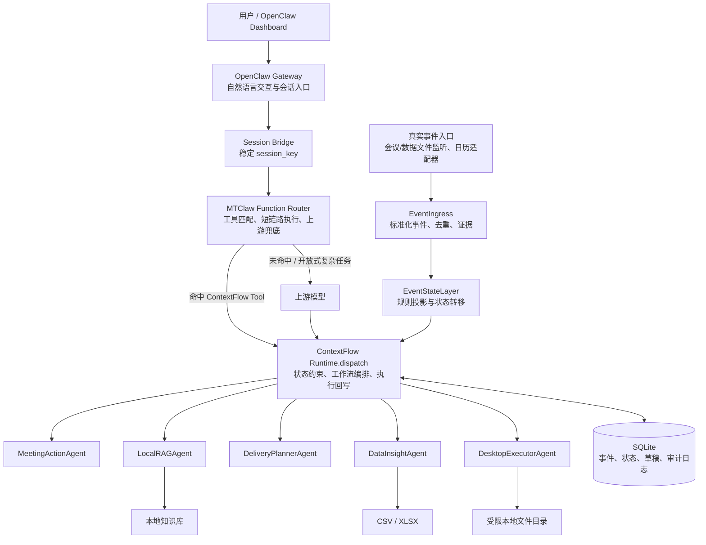
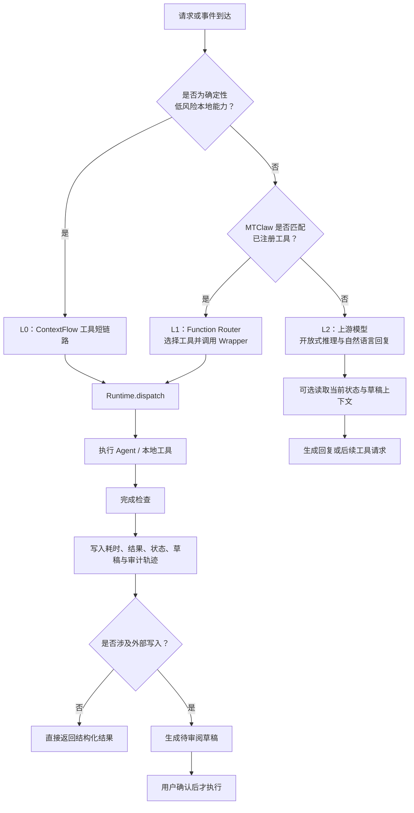
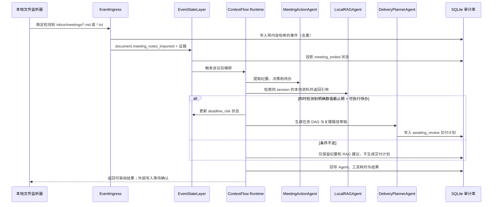

# MTClaw × ContextFlow：路由、状态感知与状态转移说明

## 1. 为什么使用 MTClaw

OpenClaw 提供自然语言交互和 Agent Gateway，但一次请求不一定都需要走完整的大模型推理链路。对于确定、低风险、可本地执行的任务，例如读取当前状态、搜索文件、导入本地资料、生成归档计划，完整长链路会增加用户等待时间，也更容易产生无效工具调用。

MTClaw Function Router 位于 OpenClaw 与工具之间，是一个 OpenAI-compatible Provider。它的作用是：

1. 接收 OpenClaw 的请求；
2. 根据工具定义和请求内容判断是否命中工具；
3. 对命中的短链路任务加载并执行工具；
4. 当任务不匹配工具、需要开放式推理，或工具无法完成时，交给上游模型继续处理；
5. 保存工具调用与完成检查信息。

因此，MTClaw 解决的是“**何时不必让大模型承担全部执行成本**”的问题；ContextFlow 则在它之上补齐“**当前用户处于什么工作状态、哪些 Agent 能执行、执行后如何回写**”的问题。

```text
OpenClaw：自然语言交互 / Agent Gateway
        ↓
MTClaw Function Router：轻量路由 / 工具执行 / 上游模型兜底
        ↓
ContextFlow Runtime：状态感知 / Agent 约束 / Workflow 编排 / 审计回写
        ↓
本地文件、SQLite、知识库、数据分析、桌面执行工具
```

## 2. ContextFlow 对 MTClaw 的二次开发点

ContextFlow 不修改 MTClaw 的核心路由代码，而是通过其标准工具扩展机制完成二次开发。

| 扩展位置 | ContextFlow 改动 | 作用 |
|---|---|---|
| `mtclaw/functions.jsonl` | 注册 22 个 ContextFlow Tool Schema | 让 MTClaw 识别状态、会议、RAG、数据、桌面执行等能力 |
| `mtclaw/scripts/*.sh` | 为每个工具提供 Bash Wrapper | 将 Router 的工具调用安全转发到 Python Runtime |
| `service/runtime.py` | 统一 `dispatch()` 入口 | 调度状态、Agent、工具、草稿与执行日志 |
| `service/event_ingress.py` | 事件适配器与文件监听器 | 将文件、日历、模拟事件统一为标准事件 |
| `service/event_state_layer.py` | 状态投影引擎 | 基于事件证据计算可解释的当前状态 |
| `service/meeting_orchestrator.py` | 会议后的跨 Agent 编排 | 按状态创建 RAG 建议和交付计划草稿 |
| `service/storage.py` | SQLite 持久化 | 隔离 session、保存状态、草稿、事件和审计轨迹 |

每个工具调用都经过同一条路径：

```text
Tool Schema
→ MTClaw Router
→ 同名 Bash Wrapper
→ ContextFlow Runtime.dispatch()
→ Agent / 状态机 / 本地工具
→ JSON 结果 + SQLite 审计记录
```

## 3. 请求如何路由

ContextFlow 的路由按复杂度分为三层。

### L0：确定性事件与本地短链路

当请求明确对应本地、低风险、结构化能力时，直接进入 ContextFlow 工具。例如：

- 导入会议纪要；
- 获取当前状态；
- 本地资料导入与证据问答；
- CSV/XLSX 分析；
- 文件搜索、归档计划、确认、撤销。

这类路径尽量减少无关模型推理，重点记录工具耗时、成功率和确认边界。

### L1：MTClaw Function Router 判断

当用户用自然语言提出任务，但任务是否匹配某个工具仍有歧义时，MTClaw 使用路由模型选择匹配工具。Router 加载 `functions.jsonl` 中的工具描述，执行符合条件的 Wrapper，并根据完成检查决定是否直接返回。

### L2：上游模型兜底

以下情况转交上游模型：

- 没有工具匹配；
- 用户提出开放式问题，例如“这个 PPT 的逻辑是否完整”；
- 任务需要复杂推理、写作或综合判断；
- 工具执行无法完成任务。

这不是放弃 ContextFlow：Runtime 仍可提供当前 session 的状态、已生成草稿和审计上下文；只是由更适合的模型完成开放式推理。

```text
用户请求
  ├─ 明确事件 / 本地结构化任务 → L0 ContextFlow 短链路
  ├─ 存在工具匹配但有歧义     → L1 MTClaw 路由模型选择工具
  └─ 无匹配 / 开放式复杂任务   → L2 上游模型兜底
```

## 4. 如何识别用户状态

ContextFlow 不宣称全量感知用户行为，而是使用“**事件证据 + 置信度 + 状态投影**”处理高价值工作节点。

当前支持的事件来源包括：

| 事件来源 | 例子 | 典型状态 |
|---|---|---|
| 本地会议资料目录 | `.md/.txt` 会议纪要稳定进入 `inbox/meetings` | `meeting_ended` |
| 本地数据目录 | CSV/TSV/XLSX 稳定进入 `inbox/data` | `data_ready_for_analysis` |
| 日历适配器 | 会议开始、结束、截止期更新 | `meeting_started`、`meeting_ended`、`deadline_risk` |
| 桌面活动 | 指定目录文件变化 | `focus_mode` |
| 演示模拟器 | 注入与真实事件相同格式的事件 | 用于现场兜底，不改变后续状态机逻辑 |

以会议资料为例，文件监听器需要连续扫描到同一文件稳定存在后，才发布事件，避免文件仍在复制时误触发。事件会带有稳定 `event_id`、文件内容哈希、路径、来源、发生时间和预览信息。相同文件再次到达时命中幂等保护，不重复产生工作流草稿。

标准事件示例：

```json
{
  "event_type": "document.meeting_notes_imported",
  "source": "meeting-notes-importer",
  "evidence": "项目交付会纪要.md 已进入本地会议资料目录",
  "confidence": 0.96
}
```

## 5. 状态如何转移

状态机并不直接相信模型猜测，而是使用事件优先级和明确规则投影当前状态。

```text
会议纪要文件到达
        ↓
document.meeting_notes_imported
        ↓
meeting_ended
        ↓
会议内容中同时出现：明确数值截止期 + 可执行待办
        ↓
deadline_risk
```

### 核心转移规则

| 输入证据 | 目标状态 | 条件 |
|---|---|---|
| 新会议纪要 | `meeting_ended` | 文件类型正确、内容非空、事件处于有效窗口 |
| 会议中出现“24 小时内”等明确数值期限，且存在待办 | `deadline_risk` | 仅在两个条件同时满足时升级 |
| 新数据文件稳定进入目录 | `data_ready_for_analysis` | CSV/TSV/XLSX 非空且通过监听稳定性检查 |
| 用户进入工作目录或活跃文件变化 | `focus_mode` | 近 10 分钟内存在有效活动事件 |
| 截止期接近且进度不足 | `deadline_risk` | 日历/任务事件满足阈值 |

状态记录包含：状态名、事件证据、置信度、更新时间、触发事件 ID 和 session key。状态、知识库、数据集和草稿均按 session 隔离。

## 6. 状态触发的跨 Agent 编排

以比赛主 Demo 为例：

```text
meeting_ended
  ├─ MeetingActionAgent：提取会议摘要、决策、待办和跟进草稿
  ├─ LocalRAGAgent：检索当前会话本地资料，返回可引用证据
  └─ DeliveryPlannerAgent：仅在 deadline_risk 时生成任务 DAG、负责人和关键路径
```

`DeliveryPlannerAgent` 不会在每次会议后都自动生成计划：只有检测到“明确数值截止期 + 可执行待办”时才执行。该策略避免了主动系统的过度打扰和重复编排。

所有自动产生的结果都是本地、可审阅的草稿：

- 自动：会议总结、待办提取、只读 RAG、交付计划草稿；
- 需要用户确认：发送邮件、修改日历、写入外部任务系统、执行桌面归档。

## 7. 执行回写与可审计性

ContextFlow 在 SQLite 中记录：

- 感知事件及来源；
- 状态和状态转移；
- 选择的 Agent、工具、耗时、成功/失败；
- 草稿状态和用户确认决定；
- 桌面归档操作与撤销记录。

这使评委可以验证“为什么系统进入该状态、为什么选择该 Agent、是否越权执行”，而不只是看到一段最终文本。

## 8. 与“快、准、狠”的对应

| 维度 | 机制 | 可验证证据 |
|---|---|---|
| 快 | MTClaw 将结构化本地任务分离为短链路；未命中再上游兜底 | Runtime 耗时、工具轨迹、短链路命中率、A/B 对照 |
| 准 | 事件证据、规则状态机、状态约束的 Agent 选择、来源引用 | 状态识别、RAG 证据、路由与编排专项 Benchmark |
| 狠 | 三类工作场景、五个 SubAgent、确认边界、撤销、会话隔离 | 9 项专项 Benchmark、演示日志、可安装运行工程 |

## 9. 代码入口

| 说明 | 位置 |
|---|---|
| MTClaw 工具定义 | `mtclaw/functions.jsonl` |
| Router 配置 | `mtclaw/config.contextflow.json` |
| Runtime 总入口 | `service/runtime.py` |
| 事件适配与监听 | `service/event_ingress.py`、`service/event_ingress_cli.py` |
| 状态投影 | `service/event_state_layer.py` |
| 会议编排 | `service/meeting_orchestrator.py` |
| 持久化与审计 | `service/storage.py` |
| 专项评测 | `benchmark/runner.py` |

## 10. 可用于路演的架构图



架构分工：OpenClaw 负责对话入口；MTClaw 决定请求是否可走工具短链路；ContextFlow 将事件证据投影为状态，并以状态约束 Agent、工具和工作流。模型只在需要开放式推理时介入，不取代状态机或审计链路。

## 11. 请求路由与执行反馈流程



## 12. 会议结束到交付规划的跨 Agent 流程



这条链路既可由真实文件事件触发，也可由同格式的演示事件触发；两者复用同一事件入口、状态转移和工作流逻辑。提交材料中应明确标注现场展示使用的触发来源。

## 13. 开发中遇到的问题与 MTClaw 集成解决方式

ContextFlow 的二次开发不是只新增若干 Tool Schema；重点是处理 Router 与 Runtime 在真实连续对话中的边界问题。下表记录了已处理的问题、解决方式和可复验的证据。

| 问题 | 原因定位 | 解决方式 | 验证证据 |
|---|---|---|---|
| Router 启动后 `warmup result: failure` | 私有模型地址、模型名或密钥仍为模板值，导致 MTClaw 的路由模型预热失败 | 将路由模型和上游模型配置移到私有 `contextflow.env`；启动前执行预检；保留模型不可用时的明确日志，不将密钥写入仓库 | `/health`、`/v1/tools` 正常；启动日志显示已加载 ContextFlow 工具 |
| MTClaw 能识别工具但无法调用 ContextFlow | Router 只认 `functions.jsonl` 中注册的名称，并通过同名脚本执行；Runtime 不能被 Router 直接理解 | 为每个 ContextFlow 能力同时提供 Tool Schema、同名 Bash Wrapper 和统一 `Runtime.dispatch()` 入口；Wrapper 只做参数转发 | `/v1/execute_tool` 可执行 `context_get_state`、`desktop_search_files` 等工具并返回 JSON |
| 连续对话中状态、RAG 或草稿串会话 | OpenClaw 请求、MTClaw 调用和 Runtime 存储若各自生成会话 ID，会使上下文失去隔离 | 通过 Session Bridge 和 `derive_session_key()` 将稳定 `session_key` 透传给 ContextFlow；SQLite 的状态、知识库和草稿均按该键隔离 | 不同 session 的资料检索与草稿互不可见；专项 Benchmark 覆盖 session isolation |
| 模型反复调用 `context_get_state` 或会议工具而不输出 | 工具完成信号不足、工具结果未被明确标识为已完成，模型会把同一调用误判为仍需继续执行 | 在 MTClaw 工具提示、完成检查和 Runtime 返回中补充结构化 `result=ok`、任务完成语义与最近工作流标识；对已生成的计划执行幂等保护 | 同一会议事件不会重复创建交付计划；`meeting_duplicate_event_v1` 回归用例通过 |
| 每次会议都生成交付计划，主动性变成打扰 | 仅以 `meeting_ended` 触发规划，缺乏业务阈值 | 在 `event_state_layer.py` 中把“明确数值截止期 + 可执行待办”作为 `deadline_risk` 的升级条件；`DeliveryPlannerAgent` 仅在该状态下运行 | 有截止期会议生成 DAG；无截止期会议只产出纪要与 RAG 建议，专项 Benchmark 覆盖两种分支 |
| Windows + Git Bash 环境无法稳定执行 Wrapper | `python3` 不在 Windows PATH，且 Bash/PowerShell 的路径表达不同 | 允许用 `CONTEXTFLOW_PYTHON` 指向虚拟环境的 `python.exe`；脚本将运行时解释器显式注入 Wrapper | Windows 本地可启动 Router，并完成文件搜索、归档确认、执行和撤销闭环 |
| 工具调用的 JSON 在手工测试时解析失败或中文路径乱码 | 请求体引号格式不正确，PowerShell 默认编码与 UTF-8 响应处理不一致 | 使用标准 JSON 请求体；Router 响应显式使用 UTF-8；以 `Invoke-RestMethod` / 规范化请求验证 | 带中文根目录的 `desktop_search_files` 返回正确路径和匹配文件 |

### 解决 MTClaw 集成问题的原则

1. **不替换 MTClaw 的核心职责。** 保留其 OpenAI-compatible Provider、工具匹配、Wrapper 执行和上游兜底机制；ContextFlow 以标准 Tool 扩展接入。
2. **把不确定性留给模型，把确定性留给 Runtime。** 文件事件、状态转移、确认边界、幂等和审计均不依赖模型猜测，因此可重复验证。
3. **以可观测性消除“黑箱”。** 每次工具调用记录 session、路由结果、耗时、执行结果和状态变化；出现重复调用时可从审计链路定位是模型、Router 还是 Runtime 的问题。

这部分可直接作为答辩中的“技术挑战与创新实现”页：MTClaw 解决短链路路由和模型兜底，ContextFlow 解决真实事件接入、状态化编排、循环抑制和可审计执行。

---

本项目当前已经在本机完成真实本地文件事件驱动的会议闭环和专项回归验证。MTT AIBOOK 环境应使用相同代码、固定版本和私有模型配置复测核心链路后，再形成真机性能结论。
